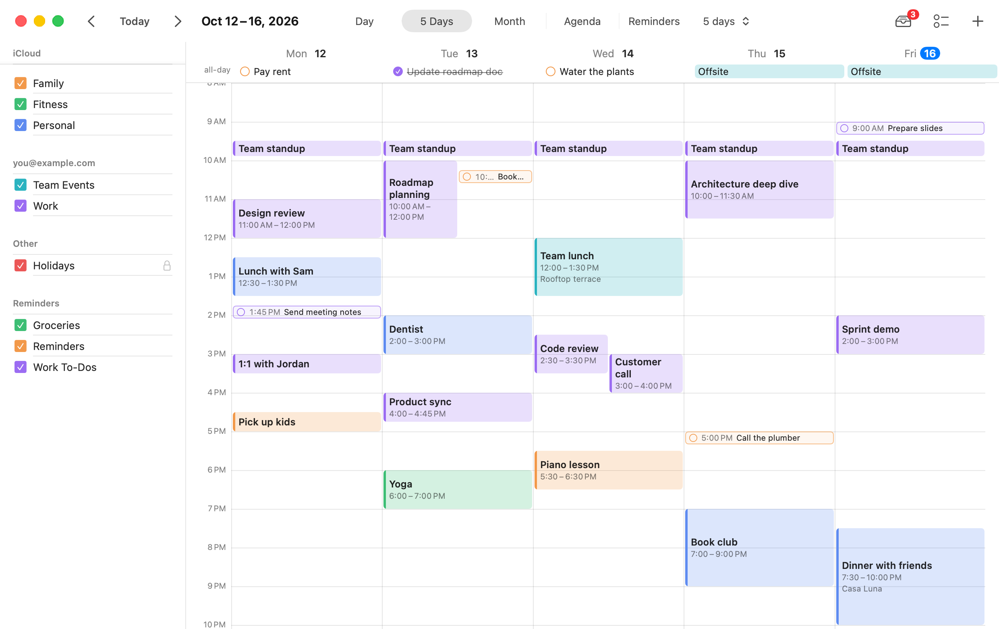
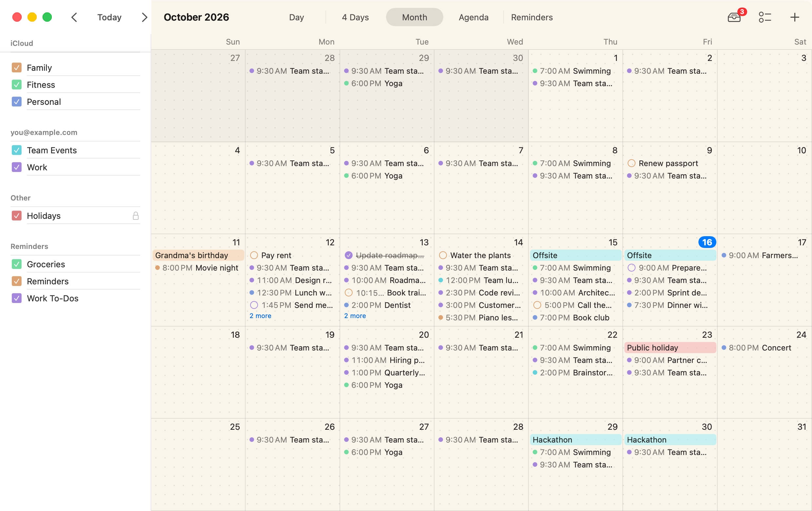
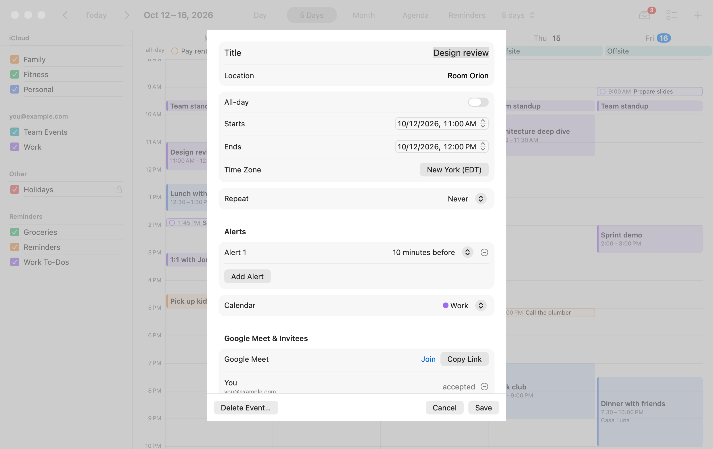
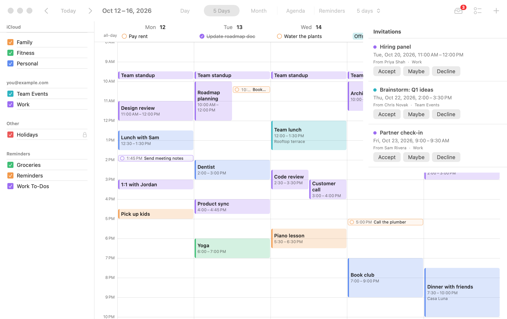
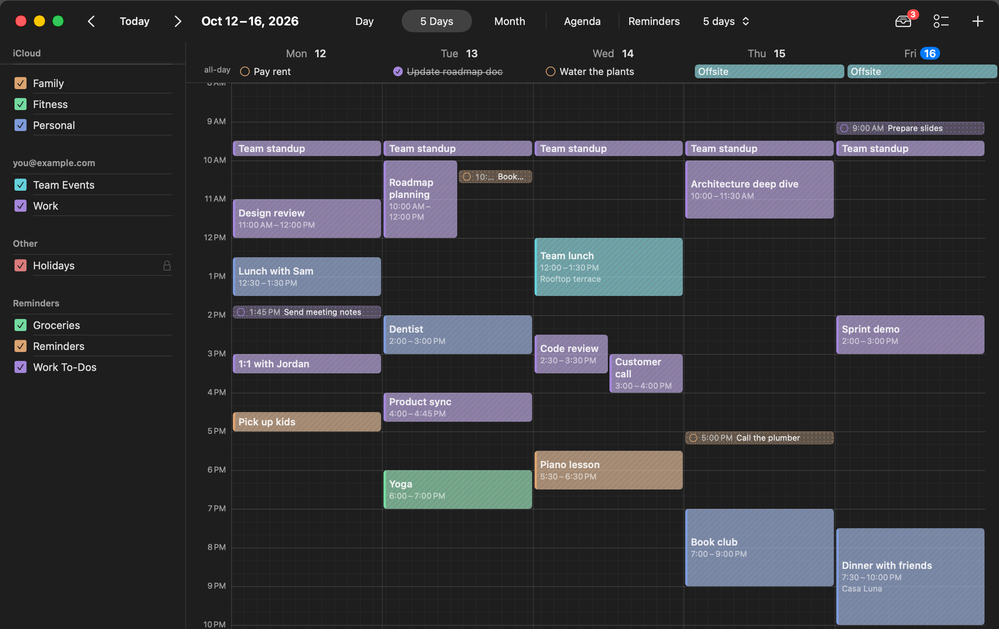
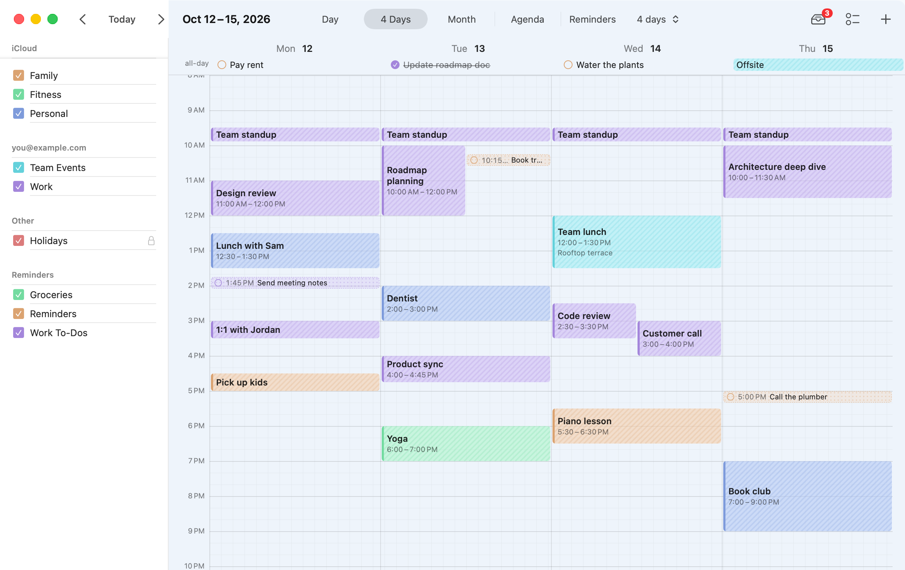
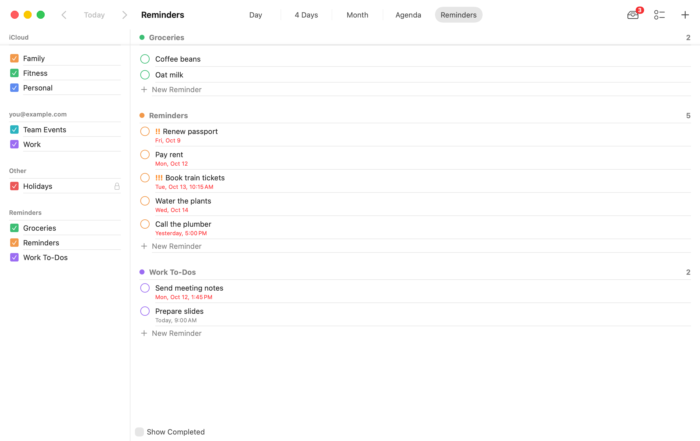
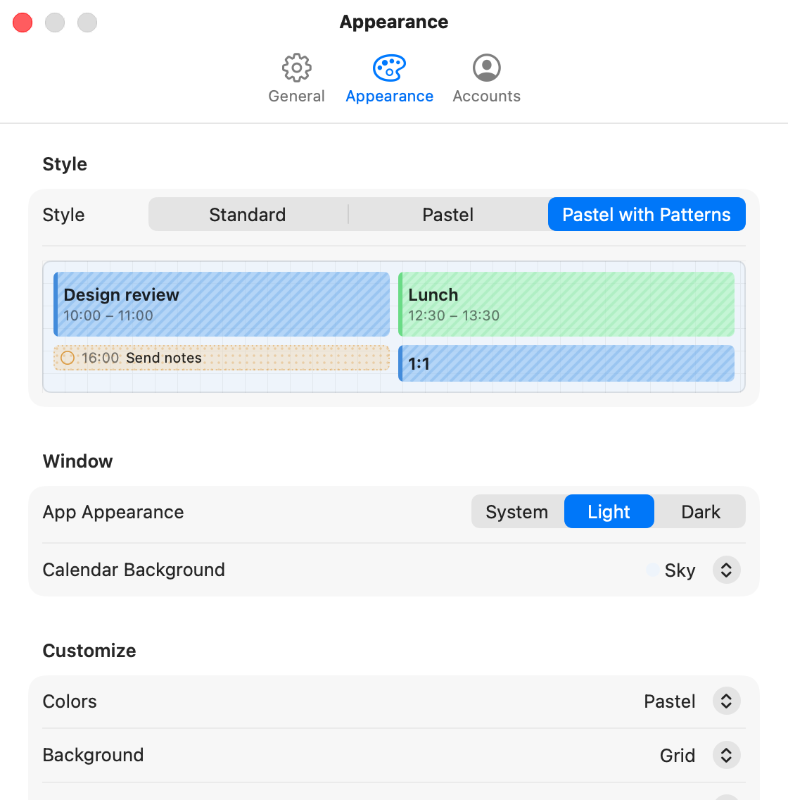

# Calendario

A native macOS calendar that puts every account on your Mac (iCloud, Google, Exchange,
CalDAV) in one color-coded view, next to your Apple Reminders. For Google calendars it
adds what Apple's Calendar app can't: Google Meet links, invitees with directory
suggestions, and answering invitations.



## Install

```bash
curl -fsSL https://raw.githubusercontent.com/Gigen/calendario/main/scripts/install.sh | bash
```

You need macOS 15 or later and [Xcode 26](https://apps.apple.com/app/xcode/id497799835).
The installer:

1. clones the source to `~/Calendario`
2. finds your Apple Team ID. Sign in to Xcode once with any Apple ID; a free one is enough.
3. picks a unique bundle ID
4. optionally sets up Google: it creates the Cloud project and enables the APIs with
   [`gcloud`](https://cloud.google.com/sdk/docs/install) if you have it, then opens the
   Console pages for the steps Google has no API for and asks for the client ID
5. builds, signs and installs `Calendario.app`

Re-run it any time, for example to add Google later. The manual steps are in
[SETUP.md](SETUP.md).

No server, no account and no telemetry: Calendario reads and writes the calendar
database macOS already syncs, and talks to Google only for the features listed below.

## Features

**All your calendars, one view.**
- Day, 2–14 days (4 by default), month and agenda views across every account in
  System Settings > Internet Accounts.
- Show or hide calendars, and recolor them for Calendario only.
- Changes show up in Apple's Calendar and Reminders apps and on your other devices,
  because they go into the same system database.

**Events.** Create, edit and delete events in any calendar you can write to:
- all-day and multi-day events, and time zones
- alerts and repeat rules ("this event" or "future events")
- double-click to create

**Reminders.**
- Timed reminders sit in the grid at their time; reminders due on a day without a time
  sit at the top.
- A Reminders view groups them by list.
- Complete, edit and delete, with a due date, an alert and a priority.



**Google Meet and invitees.** Connect your Google accounts in Settings > Accounts, then:
- one toggle adds a Meet link
- invitees get Google's invitation emails
- typing an invitee's name suggests coworkers from your Workspace directory
- organizers show in bold, and responses as colors



**Invitations inbox.**
- Every unanswered invitation, with Accept / Maybe / Decline.
- For repeating meetings, you choose this event only or the whole series.



**Styles.** Standard, Pastel and Pastel with Patterns, or mix your own:
- colors: standard or pastel
- background: dots, grid or ruled lines
- events: solid, gradient or striped
- reminders: outlined, dashed or dotted
- Light/Dark/System appearance and a background color of your choice

| | |
|---|---|
|  |  |
|  |  |

**Mac-native extras.**
- A menu bar agenda for today and tomorrow.
- Multiple windows, ⌘+/⌘− zoom, and keyboard shortcuts for everything.
- A warning when macOS has stopped syncing a connected Google account, which EventKit
  doesn't report on its own.

Week start, 12/24-hour time and time zones follow System Settings.

## Keyboard shortcuts

| Action | Shortcut |
|---|---|
| New Event / New Reminder / New Window | ⌘N / ⌥⌘N / ⇧⌘N |
| Day, Days, Month, Agenda, Reminders | ⌘1 … ⌘5 |
| Previous / Next period | ⌘← / ⌘→ |
| Go to Today / Go to Date… | ⌘T / ⇧⌘T |
| Zoom the time grid in / out / actual size | ⌘+ / ⌘− / ⌘0 |
| Refresh (ask macOS to sync) | ⌘R |
| Settings | ⌘, |

## Try it without your data

Demo mode shows fictional calendars and reminders and never touches EventKit, your
Keychain or Google:

```bash
open Calendario.app --args -demo YES
```

`scripts/screenshots.sh` regenerates the screenshots above from demo mode.

## Development

Open `Calendario.xcodeproj` (scheme **Calendario**), or build and test from the command
line:

```bash
swift test --package-path Packages/CalendarKit
```

- `Packages/CalendarKit/Sources/CalendarDomain`: the provider-independent model and all
  pure logic (Foundation only): date math, layout, recurrence, de-duplication, matching.
- `Packages/CalendarKit/Sources/EventKitProvider`: the macOS EventKit implementation.
- `Packages/CalendarKit/Sources/GoogleCalendarAPI`: OAuth with PKCE (no client secret),
  the Calendar and People APIs.
- `Calendario/`: the SwiftUI app.

[ARCHITECTURE.md](ARCHITECTURE.md) explains the layers, the Apple API restrictions,
and what a Windows client would replace.

## Known limitations

- Invitees and responses can only be changed on connected Google calendars. EventKit
  doesn't allow it for other accounts.
- Google Meet and invitees can't be changed on repeating events from the editor.
- Events created through Google appear immediately, but reach Apple Calendar on the
  next sync (usually within a minute).
- If an iCloud or Exchange account in Internet Accounts loses its sign-in, macOS stops
  syncing it silently. Calendario detects this only for connected Google accounts.
- EventKit doesn't expose reminder subtasks, tags or sections.

## License

[MIT](LICENSE)
